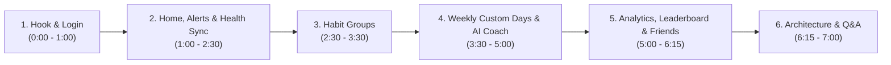

# FitBuddy — Presentation & Live Demo Playbook
**Course:** SMU IS216 Web Application Development II (WAD2)  
**Project:** FitBuddy Social Fitness & Habit Accountability Platform  
**Target Duration:** 5 to 7 Minutes  
**Audience:** Course Professors, Teaching Assistants & Grading Evaluators  

---

## 🎯 Executive Overview & Presentation Strategy

FitBuddy combines **social group accountability**, **simulated wearable telemetry with automatic habit check-in sync**, **day-ending streak protection alerts**, and **generative AI coaching**. When demonstrating this application, your goal is to showcase **technical depth** (Vue 3 `<script setup>`, Pinia, Bootstrap 5, Neon Serverless PostgreSQL, Google Gemini AI) alongside **user experience polish** (3D streak medal, instant test athlete switching, celebratory confetti, and responsive micro-interactions).

---

## 📋 Pre-Demo Setup Checklist (15 Minutes Before Demo)

1. **Browser Windows & Tabs:**
   - **Tab 1 (Primary):** `https://wad-2-fit-buddy.vercel.app` (or `http://localhost:5173`) at `/login`.
   - **Tab 2 (Documentation):** `FitBuddy_Project_Documentation.pdf` ready to showcase.
2. **Display Settings:**
   - Set browser zoom to **110%** so projected typography and cards are clearly legible.
   - Allow browser notifications for the site so the live **Time is Running Out** push alert pops up on screen.
3. **Local Dev Check (if running locally):**
   - Terminal 1: `cd server && npm run dev` (Port 3000).
   - Terminal 2: `cd FitBuddy && npm run dev` (Port 5173).
   - Health check: `http://localhost:3000/api/health` returns `{"status":"ok"}`.

---

## 👥 Team Role Distribution (For 3 to 4 Presenters)

| Speaker | Section | Focus Area |
|---|---|---|
| **Speaker 1** | **Act 1 & 2** | Problem statement, authentication, Home page overview, **Day-Ending / Time Running Out Notification**, and **Simulated Google Health Sync** |
| **Speaker 2** | **Act 3** | **Habit Groups** on the Home page & `/groups` tab (creating groups, shared activities, group check-ins & cheers) |
| **Speaker 3** | **Act 4** | Habits tracker, creating a **Weekly Habit with Custom Days (`Mon`, `Wed`, `Fri`)**, and the **Gemini AI Goal Coach** |
| **Speaker 4** | **Act 5 & 6** | Analytics Dashboard heatmap, Weekly Leaderboard podium & confetti cheers, Friends page, and Q&A |

---

## 🎬 Step-by-Step Demo Script & Visual Actions

### Act 1: The Hook & 1-Click Athlete Login (0:00 – 1:00)
- **Visual:** Display the `/login` screen.
- **Speaker Dialogue:**
  > *"Good morning professor and classmates. We are proud to present **FitBuddy** (HabitBuddy) — a full-stack social habit and fitness accountability platform built for SMU IS216 using Vue 3 Composition API, Pinia, Bootstrap 5, Express 5, and Neon Serverless PostgreSQL.  
  > Most people abandon fitness habits because manual tracking is tedious, they forget before the day ends, and they lack social support. FitBuddy solves all three."*
- **Live Action:**
  1. Log in as **`demo@fitbuddy.com`** (`password123`) or use the **Switch** menu in the navbar to switch between the 5 pre-seeded test athletes (`You`, `Alex Tan`, `Bernice Lim`, `Charlie Wong`, `David Lee`).
  2. Land on `/home`, showing the greeting, today's completion bar, the interactive **3D Streak Medal**, and the auto-scrolling **Your highlights** carousel.

---

### Act 2: Day-Ending Notification & Simulated Google Health Sync (1:00 – 2:30)
- **Visual:** The `/home` page.
- **Live Action 1 (Time is Running Out / Day-Ending Alert):**
  1. Point out the yellow Bootstrap warning alert banner (`DayEndingBanner.vue`) at the top of `/home`:
     > *"Only Xh Ym left before the day ends — N habits still left today."*
  2. Click **`Send alert`** on the banner (or open the Account Menu -> **Notifications** and click **Trigger "Time is Running Out" Alert**).
  3. Show the immediate confirmation and browser push notification warning the user to finish their remaining habits before midnight so they don't lose their streak!
- **Live Action 2 (Simulated Google Health Activity Sync):**
  1. Scroll to the **Google Health (`Simulated`)** card on the right column of `/home`.
  2. Point out the 4 colour-coded progress bars: **Steps**, **Active minutes**, **Distance**, and **Calories**.
  3. Click the **Simulation settings** slider button (`bi-sliders`), select **`5K outdoor run (+5,200 steps, 30m)`**, and click **`Simulate activity`** (or click **`Sync`**).
  4. Watch the metrics jump and point out the **Latest updates** list below the bars showing both the new wearable readings and the exercise habits that were automatically logged in Neon PostgreSQL!

---

### Act 3: Habit Groups on the Home Page & `/groups` (2:30 – 3:30)
- **Visual:** Focus on the **Habit groups** card on `/home` (`GroupsSection.vue`), then click **Open groups** (`/groups`).
- **Speaker Dialogue:**
  > *"Right on the Home page, we replaced individual active challenges with our **Habit Groups** feature so friends can build habits together as a team."*
- **Live Action:**
  1. On `/home`, click **`+ New group`** in the **Habit groups** card, enter *"Morning Runners"*, check **Alex Tan** and **Bernice Lim**, and click **`Create group`**.
  2. Click **`View group`** (or navigate to the **Groups** tab `/groups`), add a shared activity (e.g. *"5K Group Run"*, 20 pts/day), and click **`Check in`** right from the Home page or Groups page to earn group points and trigger celebratory confetti!

---

### Act 4: Weekly Habits with Custom Days & Gemini AI Goal Coach (3:30 – 5:00)
- **Visual:** Navigate to **`Habits`** (`/habits`) in the top bar.
- **Live Action 1 (Weekly Habit with Custom Days):**
  1. Click **`+ New habit`**.
  2. Type Name: **`Gym Strength Session`**.
  3. Change **Frequency** from `Daily` to **`Weekly`**.
  4. Point out the **`Custom days (optional)`** selector (`Mon` through `Sun` Bootstrap toggle buttons).
  5. Click **`Mon`**, **`Wed`**, and **`Fri`** — show the helper text updating to *"Scheduled on: Mon, Wed, Fri"*.
  6. Set Weekly target to `3` `sessions` and click **`Create habit`**.
  7. Point out the new habit card displaying **`Exercise · Weekly · Mon, Wed, Fri`** (and a **`Scheduled today`** badge if today is one of the selected days!).
- **Live Action 2 (Gemini AI Goal Coach Chatbot):**
  1. Click the round **`Ask me anything!`** AI Coach button in the bottom-right corner of `/habits`.
  2. Click a starter chip or type *"Help me train for a 5K run"*.
  3. Show the multi-turn coach reply and structured habit suggestion cards, and click **`+ Add`** to add a suggested habit directly to your list!

---

### Act 5: Analytics Dashboard, Leaderboard & Friends (5:00 – 6:15)
- **Visual:** Click through **`Dashboard`** (`/dashboard`), **`Leaderboard`** (`/leaderboard`), and **`Friends`** (`/friends`).
- **Live Action:**
  1. **Dashboard (`/dashboard`):** Show the 3-colour **Month at a glance** calendar heatmap, **Daily completion trend** chart, and **Habits & streaks** breakdown.
  2. **Leaderboard (`/leaderboard`):** Show the top-3 podium with the 3D trophy, toggle between **Global** and **Friends**, and click **`Cheer`** (`👏`) on **Alex Tan** to fire confetti (`once per day` rule enforced by the server).
  3. **Friends (`/friends`):** Click Alex Tan's name to view his **Friend Profile** (`/friends/rival_alex`), or scroll down to start a head-to-head friend challenge.

---

### Act 6: Architecture Wrap-Up & Q&A (6:15 – 7:00)
- **Key Highlights to Mention:**
  - **Strict WAD2 Syllabus Adherence:** Built with Vue 3 `<script setup>`, Pinia stores, plain Axios with `authConfig()`, Vue Router guards, and Bootstrap 5 components. Any non-syllabus browser/Vue lifecycle helpers (`onUnmounted`, `watch`, `Teleport`, Three.js canvas) are explicitly documented with `// Beyond WAD2 syllabus:` comments.
  - **Cloud-Native Deployment:** Hosted on **Vercel** (`vercel.json` + `api/index.js`) backed by **Neon Serverless PostgreSQL** with automatic schema migration (`initNeonSchema`).
