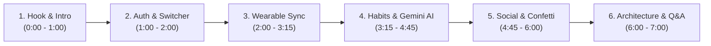

# FitBuddy — Presentation & Live Demo Playbook
**Course:** SMU IS216 Web Application Development II (WAD2)  
**Project:** FitBuddy Social Fitness & Habit Accountability Platform  
**Target Duration:** 5 to 7 Minutes  
**Audience:** Course Professors, Teaching Assistants & Grading Evaluators  

---

## 🎯 Executive Overview & Presentation Strategy

FitBuddy combines **relational social accountability**, **automated wearable telemetry**, and **generative AI coaching**. When demonstrating this application, your goal is to showcase **technical depth** (Vue 3 Composition API, Neon Serverless PostgreSQL, Google Gemini 2.5 Flash) alongside **user experience polish** (instant test athlete switching, celebratory confetti, responsive micro-interactions).

---

## 📋 Pre-Demo Setup Checklist (15 Minutes Before Demo)

1. **Browser Windows & Tabs:**
   - **Tab 1 (Primary):** `http://localhost:5173` (or your live Vercel URL) at `/login`.
   - **Tab 2 (Backup/Inspection):** [console.neon.tech](https://console.neon.tech) SQL Editor for `wild-haze-13789239`.
   - **Tab 3 (Documentation):** `FitBuddy_Project_Documentation.pdf` ready to showcase.
2. **Display Settings:**
   - Set browser zoom to **110%** so projected typography and cards are clearly legible.
   - Close all background notifications, messengers, and unrelated browser tabs.
3. **Local Dev Check (if running locally):**
   - Ensure Express backend is running: `node --env-file-if-exists=.env.local server/server.js` (Port 3000).
   - Ensure Vite frontend is running: `npm --prefix FitBuddy run dev` (Port 5173).
   - Verify health check: `http://localhost:3000/api/health` returns `{"status":"ok"}`.

---

## 👥 Team Role Distribution (For 3 to 4 Presenters)

| Speaker | Section | Focus Area |
|---|---|---|
| **Speaker 1** | **Act 1 & 2** | Introduction, problem statement, authentication security, and 1-click test athlete switcher |
| **Speaker 2** | **Act 3** | Dashboard overview, wearable health sync simulator (Apple Health / Google Fit), and consistency analytics |
| **Speaker 3** | **Act 4** | Habits tracker, interactive 7-day dot matrix, and Google Gemini 2.5 Flash AI Goal Coach |
| **Speaker 4** | **Act 5 & 6** | Social leaderboard, confetti cheer engine, head-to-head duels, cloud architecture & lead Q&A |

*(If presenting solo or in pairs, simply combine Acts 1–3 and Acts 4–6).*

---

## 🎬 Step-by-Step Demo Script & Visual Actions

### Act 1: The Hook & Problem Statement (0:00 – 1:00)
- **Visual:** Display the FitBuddy `/login` screen with the hero banner.
- **Speaker Dialogue:**
  > *"Good morning professor and fellow classmates. We are proud to present **FitBuddy**—a full-stack, cloud-native social habit and fitness accountability platform built for SMU IS216.  
  > Studies show that over 80% of individuals abandon fitness resolutions within six weeks due to lack of social accountability, tedious manual tracking, and generic workout routines. FitBuddy solves all three challenges by combining automated wearable telemetry, peer accountability with head-to-head challenges, and personalized generative AI coaching."*
- **Key Talking Points:**
  - Modern tech stack: **Vue 3 Composition API (`<script setup>`)**, **Bootstrap 5**, **Express 5**, **Neon Serverless PostgreSQL**, and **Google Gemini 2.5 Flash**.

---

### Act 2: Authentication & The 1-Click Test Athlete Switcher (1:00 – 2:00)
- **Visual:** Focus on the login card and the **"⚡ Quick Test Athletes"** section.
- **Speaker Dialogue:**
  > *"Security and multi-user isolation are core to FitBuddy. We implemented salted `scrypt` key derivation with random 16-byte salts and stateless HMAC-SHA256 JWT tokens.  
  > To make grading and evaluation seamless, we built a 1-click test athlete switcher. This pre-authenticates five distinct personas: our demo student, track athlete Alex Tan, crossfit athlete Bernice Lim, marathon runner Charlie Wong, and powerlifter David Lee."*
- **Live Action:**
  1. Click **`You (Demo)`** button.
  2. The button highlights, shows a micro-spinner, authenticates via `POST /api/auth/login`, and redirects cleanly to `/dashboard`.

---

### Act 3: The Command Center & Wearable Telemetry Sync (2:00 – 3:15)
- **Visual:** The `/dashboard` view with streak counters, health sync widget, 7-day consistency matrix, and challenges.
- **Speaker Dialogue:**
  > *"Welcome to the athlete's command center. At a glance, users see their current streak, weekly consistency score, and active duels.  
  > One of our flagship features is the **Wearable Telemetry Sync Engine**. Recognizing that browser applications lack hardware pedometers and that production Google Fit OAuth requires multi-thousand-dollar CASA audits, we built a production-grade device ingestion pipeline."*
- **Live Action:**
  1. Point out the initial Daily Steps (e.g. 6,420 steps) and Active Distance.
  2. Click **"Sync Apple Health"** or **"Google Fit"**.
  3. Watch the button show *"Syncing..."*, celebratory confetti burst, and metrics jump to **8,500+ steps**, **45 active minutes**, and **350+ kcal**.
  4. Point out the green notification banner: *"Successfully synchronized data from Apple Health! Automatically checked in for: Morning run, Stretch"*.
- **Technical Emphasis:**
  > *"Notice what just happened: this wasn't just a client-side animation. The backend queried the user's active habits in Neon PostgreSQL, found matching cardio and wellness habits, and automatically committed real check-in rows to our cloud database."*

---

### Act 4: Habit Management & Gemini AI Goal Coach (3:15 – 4:45)
- **Visual:** Navigate to `/habits` using the top navbar.
- **Speaker Dialogue:**
  > *"In our Habits management suite, users have full CRUD control with instant category filtering across Fitness, Nutrition, Mindfulness, and Recovery. Each habit card features an interactive 7-day dot matrix."*
- **Live Action 1 (Interactive Dot Matrix):**
  1. Hover over today's date circle on *"Stretch"* or *"Morning run"*.
  2. Click the circle — it instantly toggles to completed (`✔`) with optimistic UI updates and saves to Neon PostgreSQL.
- **Live Action 2 (Gemini AI Goal Coach):**
  1. Click the glowing **"AI Goal Coach"** button at the top right.
  2. In the modal, select objective: *"Half-Marathon Training"* (or type: *"I want to run my first 10K race in 8 weeks"*).
  3. Select fitness level: *"Beginner"*.
  4. Click **"Get Coaching Advice"**.
  5. In 1.5 seconds, Google Gemini 2.5 Flash streams structured JSON recommendations:
     - Strategic progression roadmap.
     - 3 to 4 tailored atomic habits with customized icons, target frequencies, and rationale.
  6. Click **"Add to My Habits"** on one of the recommended habits.
  7. Close the modal — demonstrate that the new habit is now immediately visible in your active habit cards!
- **Technical Emphasis:**
  > *"We utilize Google's latest Gemini 2.5 Flash model with strict JSON schema enforcement (`responseMimeType: 'application/json'`). This guarantees that AI recommendations strictly match our database schema with zero hallucinations."*

---

### Act 5: Social Leaderboard, Peer Cheers & Duels (4:45 – 6:00)
- **Visual:** Navigate to `/leaderboard`.
- **Speaker Dialogue:**
  > *"Accountability flourishes with peers. Our leaderboard isn't a static list—it is powered by an aggregated PostgreSQL query that dynamically computes weekly scores based on check-ins completed, all-daily bonuses, and 7-day milestones."*
- **Live Action 1 (Podium & Confetti Cheers):**
  1. Show the Gold, Silver, and Bronze podium cards.
  2. Locate **Alex Tan** on the leaderboard.
  3. Click the **"Cheer"** button on Alex Tan.
  4. A burst of festive confetti fires across the screen (`canvas-confetti`), and Alex's cheer counter increments.
- **Live Action 2 (Multi-User Verification):**
  1. In the top navbar, click the **"Switch"** dropdown and select **Alex Tan**.
  2. Notice the navbar avatar immediately changes to Alex's color.
  3. Point out the **"Recent Buddy Cheers & Nudges"** inbox at the top of the leaderboard showing: *"You sent you a 🎉 Cheer!"*.
- **Live Action 3 (Head-to-Head Duels):**
  1. Return to `/dashboard`.
  2. Show the **Friend Challenges & Head-to-Head Duels** card.
  3. Point out the split dual progress bar showing *"You: 5/7 days"* vs *"Alex Tan: 3/7 days"*.
  4. Click **"Log Progress"** to advance the duel bar in real time!

---

### Act 6: Cloud Architecture & Engineering Wrap-up (6:00 – 7:00)
- **Visual:** Open Tab 3 to show the architecture diagram in [`FitBuddy_Project_Documentation.pdf`](file:///c:/Users/User/OneDrive/Desktop/College/Year%203/IS216%20WAD2/Group%20project/project/FitBuddy_Project_Documentation.pdf).
- **Speaker Dialogue:**
  > *"To summarize our architectural decisions:  
  > 1. We built a **dual-root monorepo** with automated compilation scripts (`scripts/build.js`) enabling zero-config deployment to Vercel Serverless Functions.  
  > 2. We utilize **Neon Serverless PostgreSQL** with connection pooling and self-healing schema migrations (`initNeonSchema`).  
  > 3. We maintain documentation integrity and full testing coverage with our 11-step automated verification suite (`verifyAllEndpoints.js`), verifying all endpoints before every release.  
  > Thank you, and we welcome any questions!"*

---

## 🧠 Anticipated Professor Q&A & Model Answers

### Q1: "How do you ensure data security and prevent SQL injection or auth bypasses?"
> **Model Answer:**  
> *"We follow strict defense-in-depth principles:  
> 1. Passwords are never stored in plaintext—they are hashed using Node's cryptographic `scrypt` algorithm with a unique 16-byte cryptographically random salt (`crypto.randomBytes(16)`).  
> 2. Session authorization uses stateless HMAC-SHA256 JWT tokens verified via our `requireUser` middleware.  
> 3. For database security, all Neon PostgreSQL operations use parameterized tagged templates (`sql\`SELECT ... WHERE user_id = ${userId}\``), completely neutralizing SQL injection risks."*

### Q2: "Why did you choose Neon Serverless PostgreSQL instead of MongoDB or local SQLite?"
> **Model Answer:**  
> *"Relational integrity and scalability. Streak milestones, leaderboard points, and multi-user cheers require strict ACID transactions and foreign key constraints between users, habits, and check-ins. Neon provides serverless autoscaling with scale-to-zero efficiency and HTTP/WebSocket connection pooling optimized for serverless Vercel functions."*

### Q3: "How does the Gemini AI integration prevent malformed responses?"
> **Model Answer:**  
> *"We enforce structured output using Gemini's `generationConfig` with `responseMimeType: 'application/json'` and an explicit `responseSchema`. Furthermore, our backend controller parses and sanitizes every suggested habit against our schema enum boundaries (`HABIT_CATEGORIES`, `HABIT_FREQUENCIES`) before sending it to the client."*

### Q4: "How does your leaderboard calculate points?"
> **Model Answer:**  
> *"Points are calculated dynamically on-the-fly using a rolling 7-day calendar window:  
> $$\text{Score} = (\text{Check-ins Completed} \times 10) + (\text{Perfect Days Bonus} \times 25) + (\text{7-Day Milestones} \times 50)$$  
> This incentivizes daily consistency over sporadic bulk completions."*

---

## 🚨 Emergency Troubleshooting & Backup Plans

| Scenario | Immediate Fix during Demo |
|---|---|
| **Slow Campus Wi-Fi** | Use local development (`http://localhost:5173`) which runs 100% offline from your local machine. |
| **Accidental Logout** | Use the 1-click test athlete switcher on `/login` to re-enter in 0.5 seconds. |
| **Gemini AI Rate Limit** | The AI Goal Coach modal has a fallback key input field where you can paste a backup API key directly. |
| **Need to Reset Demo State** | Click **"Sync Apple Health"** on `/dashboard` to immediately generate fresh telemetry and advance streaks. |
